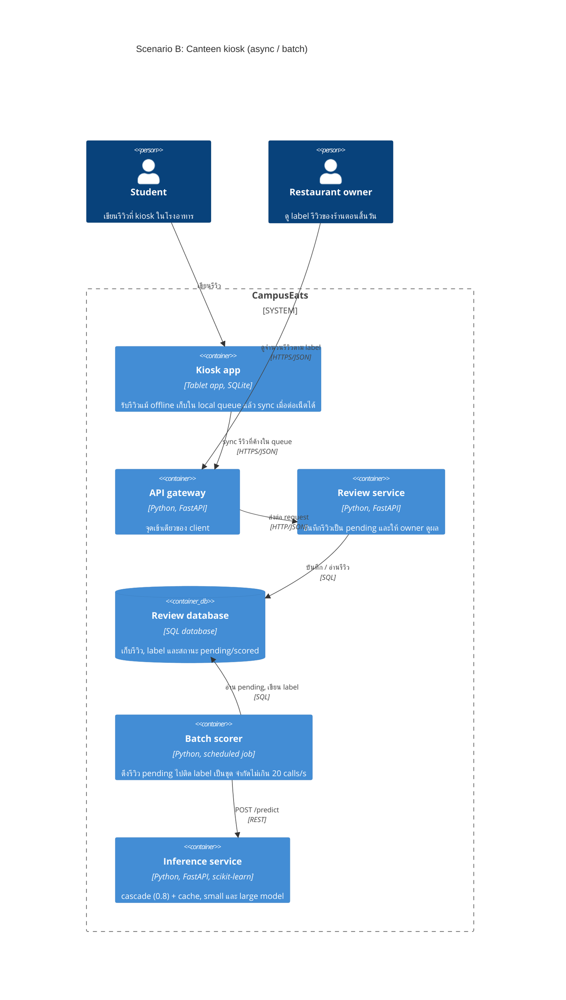

# Task 4: Deployment topologies and trade-offs

**Name / ชื่อ: นาย ปิยปาณชนก มีบุญสล้าง**

**Student ID / รหัสนิสิต: 6630196021**

This is **individual work**: each student completes and submits their own copy, in their own fork.

*งานนี้เป็น**งานเดี่ยว** นิสิตแต่ละคนทำและส่งงานของตัวเอง ใน fork ของตัวเอง*

**Scenario (A, B or C) / Scenario ที่เลือก: B (Canteen kiosk)**

Choose **one** scenario below. If the last digit of your student ID is odd, take A or B; if it is even, take B or C. Use your measurements from Tutorial 6 as evidence: cite run names from `results/runs.csv`. Answer in Thai or English.

เลือก scenario **หนึ่ง** ข้อด้านล่าง ถ้าเลขตัวสุดท้ายของรหัสนิสิตเป็นเลขคี่ ให้เลือก A หรือ B ถ้าเป็นเลขคู่ ให้เลือก B หรือ C ใช้ผลการวัดจาก tutorial ที่ทำไปเป็นข้อมูลอ้างอิง โดยอ้างชื่อ run จาก `results/runs.csv` จะตอบเป็นภาษาไทยหรือภาษาอังกฤษก็ได้

Facts that hold in every scenario / ข้อเท็จจริงที่ใช้กับทุก scenario:

- The large model serves at most **20 calls per second** (4 calls at once × about 200 ms each), and every call costs money.

  *large model รับได้สูงสุด **20 calls ต่อวินาที** (พร้อมกัน 4 calls × ประมาณ 200 ms ต่อ call) และทุก call มีค่าใช้จ่าย*
- The small model is fast and cheap enough to run anywhere, including inside the review service or on a kiosk, but it is much less accurate on its own.

  *small model เร็วและถูกพอที่จะรันที่ไหนก็ได้ รวมถึงภายใน review service หรือบน kiosk แต่ถ้าใช้ตัวเดียวจะแม่นน้อยกว่ามาก*

## Scenarios

**A. Owner alerts.** When a customer posts a negative review, the restaurant owner gets a push notification within **2 seconds**. At the lunch peak, CampusEats receives **40 reviews per second**. A missed alert is acceptable, but a wrong alert (for example, "your customer is unhappy" when they are happy) makes owners stop trusting alerts and, in the end, ignore them.

*เมื่อลูกค้าโพสต์รีวิวเชิงลบ เจ้าของร้านจะต้องได้รับ push notification ภายใน **2 วินาที** เวลาช่วงพีคตอนเที่ยง CampusEats ได้รับรีวิวจำนวน **40 รายการต่อวินาที** การพลาด alert ไปบ้างนั้นยอมรับได้ แต่ alert ที่ผิด (เช่น "ลูกค้าไม่พอใจ" ทั้งที่จริงๆ แล้วพอใจ) จะทำให้เจ้าของร้านไม่เชื่อถือและเลิกสนใจ alert ในที่สุด*

**B. Canteen kiosk.** A tablet in each canteen lets students leave a review on the spot. However, the canteen Wi-Fi is poor: the tablets lose their connection several times a day, for minutes at a time. The system must accept every review, even while a tablet is offline. Restaurant owners need the labels **by the end of the day**.

*มี tablet ในแต่ละโรงอาหารให้นิสิตรีวิวได้ทันที อย่างไรก็ดี การเชื่อมต่อ Wi-Fi ในโรงอาหารไม่ดี ทำให้ tablet หลุดการเชื่อมต่อวันละหลายครั้ง ครั้งละหลายนาที ระบบจะต้องรับรีวิวได้ทุกรายการแม้ขณะที่กำลัง offline อยู่ และเจ้าของร้านต้องการ label **ภายในสิ้นวัน***

**C. Weekly report.** Restaurant owners want a weekly sentiment report. Nothing in producing this report has to be real-time. **Accuracy matters most** and **cost must be minimal**.

*เจ้าของร้านต้องการรายงาน sentiment รายสัปดาห์ ไม่มีอะไรที่จะต้องทำแบบ real-time ในการออกรายงานนี้ ความแม่นยำ **(accuracy) สำคัญที่สุด** และ **ค่าใช้จ่ายต้องน้อยที่สุด***

## Topologies and patterns to choose from / Topology และ pattern ที่เลือกใช้ได้

| | Topology | Where the model runs / โมเดลรันที่ไหน |
|---|---|---|
| T1 | Model as a service, synchronous | Inference service, called for each review (today's baseline) *inference service ถูกเรียกทุกรีวิว (baseline ของวันนี้)* |
| T2 | Model as a library | Inside the review service, or on the device *ภายใน review service หรือบนอุปกรณ์* |
| T3 | Hybrid | Small model locally, large model as a remote service *small model รันในเครื่อง large model เป็น remote service* |
| T4 | Asynchronous / batch | Reviews are queued (broker, W10) or stored, and scored later in bulk *รีวิวถูกเข้าคิว (broker, W10) หรือเก็บไว้ แล้วติด label ทีหลังเป็นชุด* |

Combine one topology with any of the patterns from Tutorial 6: **fallback**, **cascade** and **cache**.

*เลือก topology หนึ่งแบบ แล้วผสมกับ pattern จาก Tutorial 6 ได้ตามต้องการ: **fallback**, **cascade** และ **cache***

## 1. Quality requirements

The three most important quality requirements for your scenario, each with a number where possible.

*quality requirements ที่สำคัญที่สุด 3 ข้อของ scenario ที่เลือก ระบุตัวเลขเมื่อทำได้*

| # | Quality | Requirement |
|---|---|---|
| 1 | Availability | kiosk ต้องรับรีวิวได้ 100% แม้ Wi-Fi หลุดไปหลายนาที และต้องไม่มีรีวิวหายเลย (0 lost) พอต่อเน็ตได้ค่อยส่งขึ้น server |
| 2 | Accuracy | label ถูกอย่างน้อย 93% ของรีวิวที่ได้ label (เท่ากับ large ล้วนใน `t0-large`) และทุกรีวิวต้องได้ label ก่อนสิ้นวัน (ไม่มี pending ค้างข้ามวัน) |
| 3 | Cost | เรียก large model ไม่เกิน ~64% ของรีวิว และใช้ไม่เกิน 20 calls/s ตอนรัน batch |

## 2. Design / การออกแบบ

Your topology, the patterns you add, and a container-level diagram (C4 level 2). The C4 diagram must be written in Mermaid.

*topology ที่เลือก pattern ที่เพิ่ม และ diagram ระดับ container (C4 level 2) เขียนด้วย Mermaid*

**Topology:** T4 Asynchronous / batch

- kiosk เก็บรีวิวลง local queue (SQLite บน tablet) ก่อนเสมอ แล้วค่อย sync ขึ้น server ตอนเน็ตกลับมา (store-and-forward) นักศึกษากดส่งแล้วได้ "บันทึกแล้ว" ทันที ไม่ต้องรอเน็ตหรือรอ model
- review service บันทึกทุกรีวิวลง database เป็น `pending` ก่อน ไม่เรียก model ตอนรับรีวิว
- batch scorer รันเป็นรอบๆ ระหว่างวัน (เช่นทุก 1 ชม.) และรอบสุดท้ายก่อนสิ้นวัน ดึงรีวิว pending ไปติด label แล้วเขียนกลับ

**Patterns ที่ใส่:**

- **Cascade (threshold 0.8):** ให้ small ตอบก่อน ไม่มั่นใจค่อยส่ง large ได้ accuracy เท่า large ล้วนแต่เรียก large น้อยลง เลือก 0.8 ไม่ใช่ 0.6 เพราะ batch ไม่ต้องรีบ latency ไม่สำคัญ เลยเอา accuracy ดีกว่า
- **Cache:** รีวิวจาก kiosk มักสั้นและซ้ำกัน ("Delicious!", "Too salty") เลยได้ hit เยอะ ใส่ model version ใน key กันผลเก่าค้างตอนเปลี่ยน model
- **Fallback:** ถ้า inference ค้างหรือ error ระหว่าง batch ให้รีวิวคงเป็น `pending` แล้วรอบถัดไปค่อยลองใหม่ ไม่ทำให้ทั้ง batch ล้ม

## 3. Evidence / หลักฐาน

Which runs support your choice? Show the numbers and, for scenario A, the capacity arithmetic: how many large-model calls per second does your design need at the peak?

*run ไหนที่สนับสนุนการตัดสินใจของนิสิต ให้นิสิตแสดงตัวเลขประกอบ และสำหรับ scenario A ให้นิสิตแสดงการคำนวณ capacity ด้วย เพื่อแสดงว่าในช่วงพีคนั้น design ของนิสิตต้องใช้ large model กี่ calls ต่อวินาที*

| Run | What it shows / แสดงอะไร |
|---|---|
| `t0-small` | small ตัวเดียวได้แค่ 72.5% ถ้ารัน small บน kiosk แล้วจบเลยจะไม่ผ่าน QR2 |
| `t1-before` vs `t1-after` | ตอน large ค้าง 10% แบบ sync มี errors 21 ตัว (รีวิวหาย) แต่พอมี fallback เป็น pending ได้ errors 0 pending 28 แปลว่าการเก็บไว้ก่อนแล้วติด label ทีหลังทำให้ไม่มีรีวิวหาย |
| `t2-0.8` | cascade ที่ 0.8 ได้ 93.5% เท่ากับ `t0-large` แต่เรียก large แค่ 64% ประหยัดไป 36% p50 503 ms ไม่ใช่ปัญหาเพราะเป็น batch |
| `t3-cache` | cache hit 35% ทำให้ large calls ลดจาก 53% (`t2-0.7`) เหลือ 38% โดย accuracy เท่าเดิม 93.0% |

ลองประมาณ capacity: สมมติวันหนึ่งมี 5,000 รีวิวจากทุก kiosk ถ้าใช้ cascade 0.8 จะเรียก large ประมาณ 64% = 3,200 calls (ถ้า cache ช่วยได้แบบ `t3-cache` จะน้อยกว่านี้อีก) ที่ 20 calls/s ใช้เวลาแค่ 3,200 / 20 = 160 วินาที (~3 นาที) เลยทำทันสิ้นวันสบายๆ แม้จะรันรอบเดียวตอนเย็น

## 4. ADR

Use the ADR format from W5.

*ใช้รูปแบบ ADR จาก W5*

**Title:** ใช้ async / batch scoring พร้อม offline queue บน kiosk สำหรับรีวิวจากโรงอาหาร

**Status:** Proposed

**Context:** tablet ในโรงอาหาร Wi-Fi หลุดวันละหลายครั้ง ครั้งละหลายนาที แต่ต้องรับรีวิวได้ทุกตัวไม่ให้หาย เจ้าของร้านต้องการ label แค่ภายในสิ้นวัน ไม่ต้อง real-time large model รับได้แค่ 20 calls/s และทุก call เสียเงิน ส่วน small model ตัวเดียวแม่นแค่ 72.5% (`t0-small`)

**Decision:** ใช้ T4 (asynchronous / batch) โดย kiosk เก็บรีวิวลง local queue ก่อนแล้ว sync ขึ้น server ตอนต่อเน็ตได้ review service บันทึกเป็น `pending` แล้วมี batch scorer ติด label เป็นรอบๆ ด้วย cascade threshold 0.8 + cache (key มี model version) และถ้า inference มีปัญหาก็ปล่อยให้เป็น pending ไว้รอรอบถัดไป (fallback)

**Consequences:**
- Positive: ไม่มีรีวิวหายแม้ offline เพราะเก็บไว้ที่ kiosk ก่อน, accuracy 93.5% เท่า large ล้วน (`t2-0.8`) แต่เรียก large น้อยลง 36% และ cache ช่วยลดได้อีก (`t3-cache`), batch คุมอัตราให้ไม่เกิน 20 calls/s ได้ง่าย และ model ค้างก็ไม่กระทบคนเขียนรีวิว
- Negative: label ไม่ได้ทันที เจ้าของร้านต้องรอถึงรอบ batch, ต้องเพิ่มของที่ต้องดูแล (local queue บน tablet, database, scheduled job), ต้องจัดการรีวิวซ้ำตอน sync (เช่นใส่ id ให้แต่ละรีวิวเพื่อกันส่งซ้ำ) และถ้า tablet พังก่อน sync รีวิวที่ค้างในเครื่องอาจหายได้

**Alternatives considered:** at least one topology you rejected, and why.

*อย่างน้อยหนึ่ง topology ที่ไม่เลือก และเหตุผล*

> - **T1 (sync service):** ตอน Wi-Fi หลุด kiosk เรียก service ไม่ได้เลย รีวิวหาย ผิด QR1 ทันที และตอน large ค้างก็เจอแบบ `t1-before` ที่มี errors 21 ตัว
> - **T2 (small model บน kiosk อย่างเดียว):** ทำงาน offline ได้ แต่แม่นแค่ 72.5% (`t0-small`) ไม่ผ่าน QR2
> - **T3 (hybrid):** ได้ label เบื้องต้นจาก small ทันทีบน kiosk แต่ scenario นี้ไม่ต้องการ label ทันที แถมยังต้องมี queue ไว้รอ large ตอน offline อยู่ดี เลยซับซ้อนกว่าโดยไม่ได้อะไรเพิ่ม
